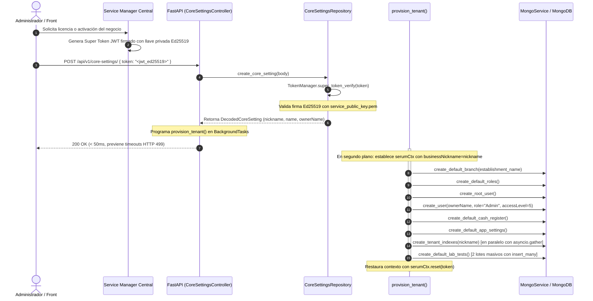

# 🏢 Arquitectura Multi-Tenant y Aprovisionamiento Dinámico

Este documento describe en profundidad el modelo **Multi-Tenant (Database-per-Tenant)** del sistema **Serum App**, detallando su justificación técnica, el ciclo de vida de activación y aprovisionamiento, la resolución en tiempo de ejecución mediante `contextvars.ContextVar`, y la integración de extremo a extremo con el cliente móvil y desktop desarrollado en Flutter.

---

## 1. Filosofía del Modelo: Database-per-Tenant

A diferencia de las arquitecturas multi-tenant tradicionales basadas en un discriminador de columna (`tenant_id`) sobre colecciones compartidas, Serum App implementa un modelo **Database-per-Tenant** puro: **cada laboratorio clínico cuenta con su propia base de datos física independiente en MongoDB**, cuyo nombre coincide con su `nickname` comercial (ej. `laboratorio_central`, `clinica_norte`).

### Justificación Técnica y Normativa

| Dimensión | Enfoque de Discriminador (`tenant_id`) | Enfoque Serum (`Database-per-Tenant`) |
| :--- | :--- | :--- |
| **Aislamiento de Datos** | Lógico. Un error de filtrado en una consulta puede exponer datos de otros clientes. | **Físico/Estructural**. Es matemáticamente imposible consultar datos de otro tenant sin cambiar explícitamente de base de datos. |
| **Cumplimiento y Privacidad** | Alto riesgo para normativas de salud (HIPAA, GDPR, NOM-024) que exigen confidencialidad médica absoluta. | **Cumplimiento nativo**. La base de datos de un laboratorio puede respaldarse, cifrarse o destruirse sin afectar a otros. |
| **Rendimiento e Índices** | Índices gigantescos compartidos. Contención de lectura/escritura y fragmentación de índices. | **Rendimiento predecible**. Índices compactos dedicados exclusivamente al volumen del laboratorio correspondiente. |
| **Mantenimiento y Backups** | Los respaldos selectivos por cliente son lentos y complejos (requieren exportaciones por filtro). | **Operaciones nativas con `mongodump`**: Respaldos y restauraciones instantáneas por laboratorio. |
| **Complejidad del Código** | Requiere inyectar `tenant_id` en todas las queries y métodos de repositorios. | **Transparencia total**. Los repositorios y managers operan de forma agnóstica sin contaminar firmas de métodos. |

---

## 2. Mapa de Componentes y Responsabilidades

```mermaid
flowchart TD
    subgraph Central["1. Servidor Central de Licenciamiento"]
        SM["Service Manager Server"]
        KeyGen["Firma Criptográfica Ed25519"]
    end

    subgraph Client["2. Cliente Frontend (Flutter)"]
        UI["Serum App Front (UI)"]
        HiveStorage[("Hive: app_config_box")]
        HttpTools["HttpTools (Interceptor de Headers)"]
    end

    subgraph Backend["3. Backend API (FastAPI)"]
        Router["Router /api/v1"]
        MultiTenantMW["Middleware multi_tenant_middleware"]
        CtxVar[("serumCtx: ContextVar")]
    end

    subgraph Business["4. Capa de Negocio (serum-business)"]
        Provisioner["provision_tenant()"]
        BaseCol["BaseMongoCollection._instances"]
        MongoSvc["MongoService.get_collection()"]
        AppSettingsCache[("AppSettingsTool (Caché aislada)")]
    end

    subgraph MongoEngine["5. Motor de Base de Datos (MongoDB)"]
        DB1[("DB: lab_origen")]
        DB2[("DB: clinica_sur")]
        DBN[("DB: tenant_n")]
    end

    SM -->|Emite Super Token| UI
    UI -->|Persiste Nickname| HiveStorage
    HiveStorage -->|Inyecta X-Servin / X-Tenant-Nickname| HttpTools
    HttpTools -->|Petición HTTP con Cabeceras| Router
    Router --> MultiTenantMW
    MultiTenantMW -->|set(SerumContext)| CtxVar
    CtxVar -.->|Lectura dinámica| BaseCol
    CtxVar -.->|Lectura dinámica| MongoSvc
    CtxVar -.->|Clave de indexación| AppSettingsCache
    MongoSvc -->|client.get_database(nickname)| DB1
    MongoSvc -->|client.get_database(nickname)| DB2
    MongoSvc -->|client.get_database(nickname)| DBN
    SM -->|POST /api/v1/core-settings/| Provisioner
    Provisioner -->|Crea colecciones, índices y defaults| DBN
```

---

## 3. Flujo 1: Activación y Aprovisionamiento Atómico

Cuando se despliega o da de alta un nuevo laboratorio, no se requiere reiniciar el servidor ni crear estructuras manualmente. El aprovisionamiento ocurre de forma atómica y bajo demanda.

### Diagrama de Secuencia de Activación



### Detalle de las Estructuras Creadas por `provision_tenant.py`

Ubicación: [`packages/serum-business/src/serum/core/tenant/provision_tenant.py`](file:///c:/Users/sytru/Developer/Projects/lab_project/serum_app_back/packages/serum-business/src/serum/core/tenant/provision_tenant.py)

El aprovisionamiento se ejecuta en orden estratégico para que las cuentas de acceso existan en los primeros milisegundos:

1. **Sucursal Principal**: Crea la sucursal de origen con `id: "00000000-0000-0000-0000-000000000000"`.
2. **Roles del Sistema**: Inicializa los roles por defecto (`Admin` y `Operador`).
3. **Usuario Root y Propietario (`Admin`)**: Crea de inmediato la cuenta del propietario con nivel de acceso máximo (`accessLevel: 5`) asignada a la sucursal principal para permitir inicio de sesión sin demoras.
4. **Caja Registradora Principal**: Crea la caja física inicial (`isDefault: True`, `cashBalance: 0`, `isOpen: False`).
5. **Configuraciones de Aplicación (`AppSettings`)**: Crea la configuración singleton del laboratorio (`useCost`, `usePrice2`, `allowEditPrice`).
6. **Índices de Colección en Paralelo (`MongoService.create_tenant_indexes`)**:
   - `CountersCollection`, `DoctorsCollection`, `PatientsCollection`, `LabTestsCollection`, `LabTestAccountsCollection`, `ApiKeysCollection` e índices analíticos de reportes ejecutados concurrentemente con `asyncio.gather`.
7. **Catálogo Maestro de Pruebas Clínicas en 2 Lotes Masivos (`create_default_lab_tests`)**:
   - **Lote 1 (Pruebas Individuales)**: Se procesan y se insertan todas de forma masiva con `insert_many` en `LabTests` y `LabTestAccounts` (reduciendo de 275 viajes de red a 2).
   - **Lote 2 (Perfiles y Packs)**: Resuelve en memoria los `childTestIds` e inserta los perfiles y cuentas en lote masivo. Reducción total de tiempo de 45.6s a < 0.5s.

---

## 4. Flujo 2: Resolución de Peticiones en Tiempo de Ejecución

Una vez que el tenant está activo, todas las operaciones HTTP ordinarias fluyen de forma aislada y automática a través de tres componentes acoplados:

### A. Middleware de Extracción (`multi_tenant_middleware`)
Ubicación: [`app/app_middleware/depends/multi_tenant.py`](file:///c:/Users/sytru/Developer/Projects/lab_project/serum_app_back/app/app_middleware/depends/multi_tenant.py)

Se ejecuta como una dependencia global sobre todo el árbol de rutas `/api/v1`:
- **Validación de Cabeceras**: Requiere la cabecera `x-tenant-nickname` o `X-Servin`. Si falta en una ruta protegida, rechaza de inmediato con `HTTP 400 Bad Request`.
- **Extracción de Sucursal Opcional**: Captura `x-branch` o `x-branch-id`.
- **Gestión del Contexto Seguro**:
  ```python
  new_ctx = SerumContext(
      businessNickname=tenant_nickname,
      branchId=branch_id or "",
  )
  token = serumCtx.set(new_ctx)
  try:
      yield
  finally:
      try:
          serumCtx.reset(token)
      except ValueError:
          pass
  ```
  > [!IMPORTANT]
  > El bloque `try ... finally: serumCtx.reset(token)` es crítico en servidores asíncronos concurrentes (como Uvicorn). Asegura que cuando una corrutina finaliza o el hilo cede el control en el event loop, el contexto no contamine peticiones posteriores.

### B. Diccionario de Instancias Aisladas (`BaseMongoCollection._instances`)
Ubicación: [`packages/serum-business/src/serum/services/base_mongo_collection.py`](file:///c:/Users/sytru/Developer/Projects/lab_project/serum_app_back/packages/serum-business/src/serum/services/base_mongo_collection.py)

En lugar de utilizar un singleton global estático por clase de colección (lo cual compartiría estado erróneo entre tenants), cada colección maneja un registro indexado por `nickname`:

```python
class BaseMongoCollection:
    collection_name: str = ""
    _instances: dict[str, Any]

    def __init_subclass__(cls, **kwargs):
        super().__init_subclass__(**kwargs)
        cls._instances = {}

    @classmethod
    def get_instance(cls: Type[T], nickname: str | None = None) -> T:
        target_nickname = (
            nickname
            if nickname is not None
            else (serumCtx.get().businessNickname or os.getenv("DB_NAME", "SerumDB"))
        )
        if target_nickname not in cls._instances:
            cls._instances[target_nickname] = cls(nickname=target_nickname)
        return cls._instances[target_nickname]
```

### C. Resolución de Base de Datos Dinámica (`MongoService.get_collection`)
Ubicación: [`packages/serum-business/src/serum/services/mongo_service.py`](file:///c:/Users/sytru/Developer/Projects/lab_project/serum_app_back/packages/serum-business/src/serum/services/mongo_service.py)

Cuando cualquier repositorio o colección accede a `self._collection`, delega la resolución a `MongoService`:
```python
def get_collection(
    self,
    collection_name: str,
    database_name: str | None = None,
) -> AsyncCollection[dict[str, Any]]:
    ctx = serumCtx.get()
    if database_name:
        current_db_name = database_name
    elif ctx.businessNickname:
        current_db_name = ctx.businessNickname
    else:
        current_db_name = os.getenv("DB_NAME", "SerumDB")

    db = self.client.get_database(current_db_name)
    return db.get_collection(collection_name)
```

---

## 5. Flujo 3: Aislamiento en Memoria y Caché (`AppSettingsTool`)

Ubicación: [`packages/serum-business/src/serum/tools/app_settings_tool.py`](file:///c:/Users/sytru/Developer/Projects/lab_project/serum_app_back/packages/serum-business/src/serum/tools/app_settings_tool.py)

Para optimizar lecturas recurrentes de configuración operativa (como `usePrice2`, `allowEditPrice`, etc.), el backend dispone de una caché en memoria. Para evitar fugas de configuración entre clientes concurrentes, la caché se indexa estrictamente por `businessNickname`:

```python
class AppSettingsTool:
    _cached_settings: dict[str, AppSettingInDb] = {}

    @classmethod
    async def get_settings(cls, nickname: str | None = None) -> AppSettingInDb:
        target = nickname or serumCtx.get().businessNickname or "default"
        if target not in cls._cached_settings:
            # Consulta a MongoDB bajo el tenant target y cachea por tenant
            settings = await AppSettingsRepository.get_instance().get_app_setting_by_id("Default")
            cls._cached_settings[target] = settings
        return cls._cached_settings[target]
```

---

## 6. Flujo 4: Integración con el Cliente Frontend (Flutter)

El cliente Flutter (`serum_app_front` y el paquete de dominio Dart `serum_business`) está coordinado con esta arquitectura mediante tres capas:

### A. Persistencia Local Segura con Hive
Ubicación: `serum_app_front/lib/src/core/app_config_manager.dart`

Los datos de activación (`servinNickname`, `licenseToken`, estado) se almacenan localmente en la caja cifrada `app_config_box`:
- Si la caja no contiene configuración $\rightarrow$ Redirige a la pantalla `/activation`.
- Si el negocio está configurado pero inactivo $\rightarrow$ Redirige a `/inactive`.

### B. Interceptor Automático de Cabeceras (`HttpTools`)
Ubicación: `serum_app_front/packages/serum_business/lib/src/tools/http_tool.dart`

Cada petición HTTP generada por cualquier Data Source de Dart inyecta automáticamente las cabeceras requeridas:
```dart
static Map<String, String> generateTenantHeaders() {
  final config = SerumClient.instance;
  final servinNickname = config.servinNickname;
  final branchId = config.branchId;
  return {
    "X-Agent": "Serum",
    if (servinNickname != null && servinNickname.isNotEmpty)
      "x-servin": servinNickname,
    if (branchId != null && branchId.isNotEmpty)
      "x-branch": branchId,
  };
}
```

### C. Guardias de Navegación y Verificación de Estado (`AppSessionCubit` + `AppRouter`)
1. **Ruta Inicial (`/splash`)**: Lee la configuración de Hive y consulta `GET /api/v1/auths/servin-status`.
2. **Evaluación de Licencia**:
   - Si `isActive == false` $\rightarrow$ Bloqueo inmediato en `/inactive`.
   - Si `isActive == true` $\rightarrow$ Avanza al flujo normal de autenticación (`/login`) o selección de caja operativa.
3. **Salida o Reconfiguración**: Si un usuario administrador pulsa "Salir del Negocio", se vacía `app_config_box` y la aplicación vuelve limpiamente a la pantalla de activación.

---

## 7. Preguntas Frecuentes y Guía de Operaciones

### ¿Cómo respaldo la información de un único laboratorio?
Al ser una base de datos física independiente, se ejecuta directamente en la terminal de MongoDB:
```bash
mongodump --uri="mongodb://localhost:27017" --db="mi_laboratorio_nickname" --out=/backups/
```

### ¿Cómo restauro la información de un laboratorio?
```bash
mongorestore --uri="mongodb://localhost:27017" --db="mi_laboratorio_nickname" /backups/mi_laboratorio_nickname/
```

### ¿Qué ocurre si se recibe una petición sin `X-Servin` o `x-tenant-nickname`?
El middleware [`multi_tenant_middleware`](file:///c:/Users/sytru/Developer/Projects/lab_project/serum_app_back/app/app_middleware/depends/multi_tenant.py) intercepta la llamada antes de alcanzar cualquier controlador y retorna:
```json
{
  "detail": "Missing required tenant header ('x-tenant-nickname' or 'X-Servin')"
}
```
Con código de estado HTTP **400 Bad Request**.

### ¿Cómo se ejecutan pruebas automatizadas sobre un tenant aislado?
En las suites de tests (`pytest`), basta con definir un nickname temporal y aprovisionar o ejecutar con el header correspondiente:
```python
async with AsyncClient(app=app, base_url="http://test") as client:
    response = await client.get(
        "/api/v1/patients/",
        headers={"x-tenant-nickname": "tenant_test_db"}
    )
```
Esto crea o consulta de forma 100% aislada la base de datos `tenant_test_db` sin interferir con datos de desarrollo o producción.
