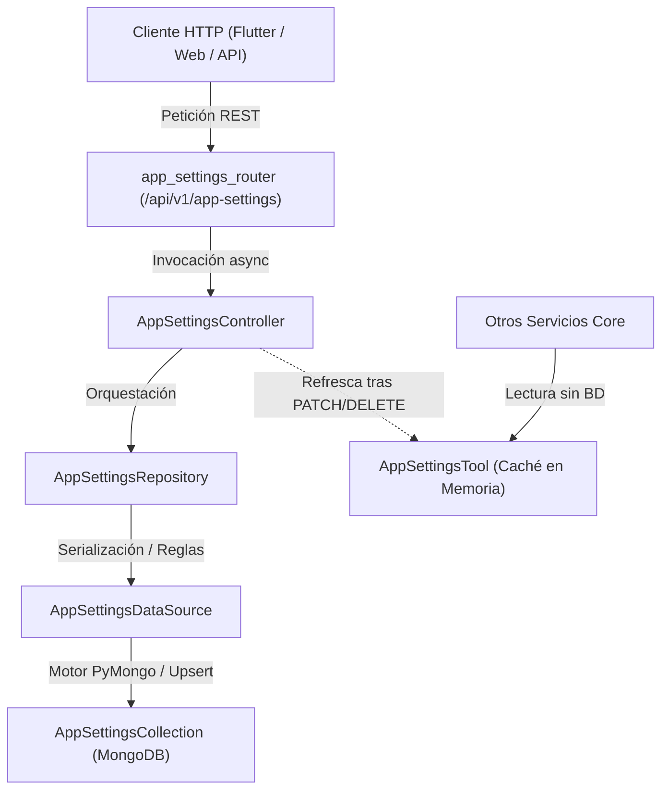

# ⚙️ Configuración Global del Sistema (`app_settings`)

El módulo **Configuración Global del Sistema (`app_settings`)** centraliza y gobierna las reglas y parámetros de comportamiento comercial y operativo en `Serum App`.

---

## 1. Arquitectura y Flujo de Datos (Onion Architecture)

El módulo sigue la arquitectura desacoplada estricta del backend:



---

## 2. Parámetros Operativos del Sistema

Por requerimiento de seguridad operativa, **todos los parámetros nacen desactivados (`False`) por defecto**:

| Parámetro | Tipo | Valor por Defecto | Descripción |
| :--- | :--- | :--- | :--- |
| `id` | `str` | `"Default"` | Identificador único del registro maestro de configuración. |
| `useCost` | `bool` | `False` | **Usar Costo:** Activa o desactiva la captura, visualización y cálculo de costos (`costPrice`) de reactivos e insumos en el catálogo clínico (`LabTest` / `LabTestAccount`). |
| `usePrice2` | `bool` | `False` | **Usar Precio 2:** Habilita la lista secundaria de precios (`salePrice2`) para convenios, aseguradoras y médicos referentes en el catálogo, cotizaciones y órdenes médicas. |
| `allowEditPrice` | `bool` | `False` | **Permitir Editar Precios:** Autoriza a los operadores de recepción y caja a editar manualmente el precio unitario final al formular órdenes o cotizaciones en el mostrador. |
| `createdAt` | `int` | Unix ms | Marca temporal de creación en milisegundos. |
| `updatedAt` | `int \| None` | `None` | Marca temporal de última modificación en milisegundos. |

---

## 3. Inicialización Automática en el Arranque (`Lifespan`)

- **Función:** `create_default_app_settings()` en `app/core/default_values/create_default_app_settings.py`.
- **Ejecución:** En `app/core/services_initializer.py`, durante el arranque del servidor (`lifespan` en `app_lifespan.py`).
- **Idempotencia:** Si la colección `AppSettings` no contiene el registro `"Default"`, se inicializa atómicamente con los valores en `False` mediante un `$setOnInsert` (`upsert=True`) en MongoDB.
- **Calentamiento de Memoria:** Inmediatamente después de inicializar la base de datos, se ejecuta `AppSettingsTool().refresh_current_app_settings()` para pre-cargar la configuración activa en RAM.

---

## 4. Herramienta Singleton en Memoria (`AppSettingsTool`)

- **Ubicación:** `app/tools/app_settings_tool.py`.
- **Propósito:** Mantener en memoria una copia caliente de la configuración activa para permitir que otros servicios (validadores de órdenes, cotizaciones, cálculo de márgenes) lean los parámetros sin realizar consultas I/O a MongoDB.
- **Sincronización:** Cada vez que el controlador ejecuta una mutación parcial (`PATCH /api/v1/app-settings/{id}`), se invoca de manera automática `AppSettingsTool().refresh_current_app_settings()`.

---

## 5. Endpoints REST (`/api/v1/app-settings`)

Controlador: `app/api/v1/app_settings/app_settings_controller.py`  
Router: `app/api/v1/app_settings/app_settings_router.py`

| Método | Endpoint | Respuesta | Descripción |
| :--- | :--- | :--- | :--- |
| `GET` | `/api/v1/app-settings/current` | `AppSettingInDb` | Retorna la configuración activa actual desde el caché en memoria de `AppSettingsTool`. |
| `GET` | `/api/v1/app-settings` | `ListResponse[AppSettingInDb]` | Lista todas las configuraciones registradas. |
| `GET` | `/api/v1/app-settings/{id}` | `AppSettingInDb` | Consulta la configuración por identificador (ej. `"Default"`). |
| `POST` | `/api/v1/app-settings` | `AppSettingInDb` | Crea un nuevo registro de configuración a partir de `CreateAppSetting`. |
| `PATCH` | `/api/v1/app-settings/{id}` | `AppSettingInDb` | Actualiza parcialmente campos (`useCost`, `usePrice2`, `allowEditPrice`), sella `updatedAt` y refresca el caché de `AppSettingsTool`. |
| `DELETE` | `/api/v1/app-settings/{id}` | `AppSettingInDb` | Elimina la configuración por `id` y refresca el caché. |

---

## 6. Frontend y Disponibilidad Global

- **Ubicación:** Módulo de **Administración** ➔ **"Configuración del sistema"** (`/admin/settings`).
- **Estado Global:** `AppSettingsCubit` es registrado como singleton en `service_locator.dart` e inyectado en `GlobalCubitProvider` (`provider_container.dart`).
- **Consumo:** Cualquier pantalla del sistema (órdenes, cotizaciones, listados) accede reactivamente a las banderas mediante:
  ```dart
  final useCost = context.watch<AppSettingsCubit>().useCost;
  final usePrice2 = context.watch<AppSettingsCubit>().usePrice2;
  final allowEditPrice = context.watch<AppSettingsCubit>().allowEditPrice;
  ```
